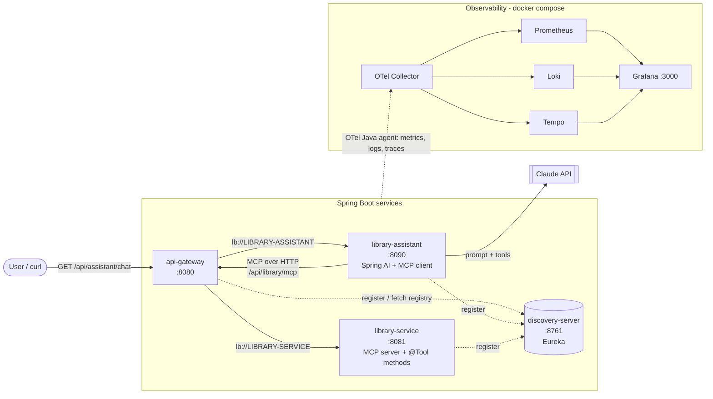
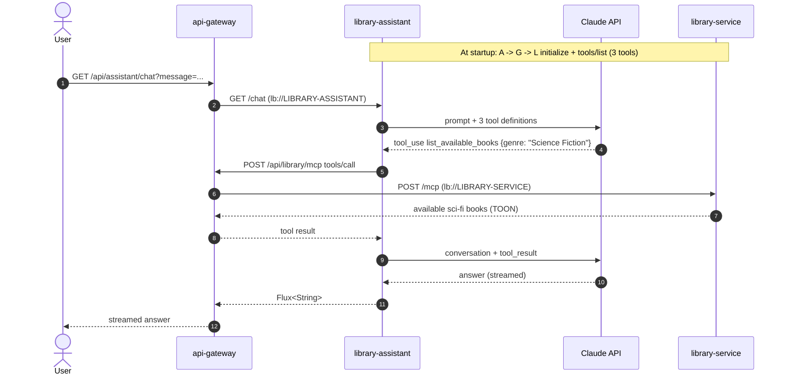

# library-mcp

An AI library assistant built as Spring Boot microservices. Ask it *"any science fiction books I can borrow?"* and it answers from the real catalog: the LLM (Claude) discovers the library's tools over the **Model Context Protocol (MCP)** and calls them through an **API gateway**, with **service discovery** and end-to-end **OpenTelemetry** observability.


## Architecture



| Service | Port | Role |
| --- | --- | --- |
| `discovery-server` | 8761 | Eureka service registry. Services register by name; the gateway resolves `lb://` names here. |
| `api-gateway` | 8080 | Spring Cloud Gateway. Single entry point; routes and load-balances `/api/library/**` and `/api/assistant/**`. |
| `library-service` | 8081 | Book catalog. Publishes three `@Tool` methods as a **stateless MCP server** at `/mcp`. |
| `library-assistant` | 8090 | Spring AI `ChatClient` on Claude. **MCP client**: discovers the tools at startup and lets the model call them. |

The assistant has no compile-time dependency on the library service: it only knows the gateway URL. Tools, their descriptions and input schemas arrive over MCP.

### MCP tools

| Tool | Input | Returns |
| --- | --- | --- |
| `search_books` | `query`: words in title, author or genre | Matching books |
| `get_book` | `bookId`, e.g. `BK-001` | One book with copy counts |
| `list_available_books` | `genre` (optional) | Books with at least one free copy |

Results are encoded in [TOON](https://github.com/toon-format/toon) (via JToon) instead of JSON to use fewer LLM tokens.

### What happens on one chat



The gateway resolves `lb://` names from its cached copy of the Eureka registry, so Eureka is not on the request path. With the OpenTelemetry agent on, every arrow above is a span in one trace.

## Tech stack

Java 17 · Spring Boot 4.0.7 · Spring AI 2.0.0 (Anthropic, MCP server and client) · Spring Cloud 2025.1.2 (Netflix Eureka, Gateway, LoadBalancer) · JToon · OpenTelemetry Java agent · OTel Collector · Prometheus · Loki · Tempo · Grafana · Maven · Docker Compose

## Project layout

```text
library-mcp/
├── pom.xml                      # parent: versions, BOMs, modules, `otel` profile
├── discovery-server/            # com.dev.turkim.librarymcp.discovery
├── api-gateway/                 # com.dev.turkim.librarymcp.gateway   (config/RouteConfig)
├── library-service/             # com.dev.turkim.librarymcp.library
│   └── config/ model/ repository/ tools/
├── library-assistant/           # com.dev.turkim.librarymcp.assistant
│   └── config/ChatClientConfig  web/ChatController
├── observability/               # docker-compose + Collector, Prometheus, Loki, Tempo, Grafana configs
└── otel/                        # agent.properties + download scripts (the agent jar is git-ignored)
```

## Getting started

### Prerequisites

- JDK 17+ and Maven 3.9+
- Docker (for the observability stack)
- An Anthropic API key

### 1. Start the observability stack (optional but recommended)

```bash
cd observability
docker compose up -d
```

Grafana: http://localhost:3000 (no login). Check http://localhost:3100/ready and http://localhost:3200/ready.

### 2. Download the OpenTelemetry agent

```bash
./otel/download-agent.sh          # macOS / Linux / Git Bash
# or, in PowerShell:
./otel/download-agent.ps1
```

### 3. Start the services, in this order

From the repository root, one terminal each. Drop `-Potel` to run without the agent.

```bash
mvn -Potel -pl discovery-server spring-boot:run
mvn -Potel -pl api-gateway spring-boot:run
mvn -Potel -pl library-service spring-boot:run

export ANTHROPIC_API_KEY=sk-ant-...      # PowerShell: $env:ANTHROPIC_API_KEY="sk-ant-..."
mvn -Potel -pl library-assistant spring-boot:run
```

The assistant connects to the MCP server through the gateway while starting, so start it last, once `LIBRARY-SERVICE` is listed at http://localhost:8761.

**From IntelliJ IDEA:** run each `*Application` class and add these VM options (adjust the service name):

```text
-javaagent:otel/opentelemetry-javaagent.jar
-Dotel.javaagent.configuration-file=otel/agent.properties
-Dotel.service.name=library-service
```

Set the working directory to the repository root, and put `ANTHROPIC_API_KEY` in the run configuration's environment variables.

## Try it

```bash
curl -N -G "http://localhost:8080/api/assistant/chat" \
  --data-urlencode "message=Any science fiction books I can borrow right now?"
```

More questions to try:

| Message | Tool the model should call |
| --- | --- |
| `Do you have anything by George Orwell?` | `search_books` |
| `Tell me about BK-007` | `get_book` |
| `Which software books are available?` | `list_available_books` with `genre: Software` |
| `Recommend a classic I can borrow today` | `list_available_books`, then reasoning |

The `library-service` log prints `Tool call :: ...` for every call, which proves the answer comes from the catalog.

### Call the MCP server directly

```bash
# list the tools (through the gateway)
curl -s -X POST http://localhost:8080/api/library/mcp \
  -H "Content-Type: application/json" \
  -H "Accept: application/json, text/event-stream" \
  -d '{"jsonrpc":"2.0","id":1,"method":"tools/list"}'

# call one
curl -s -X POST http://localhost:8080/api/library/mcp \
  -H "Content-Type: application/json" \
  -H "Accept: application/json, text/event-stream" \
  -d '{"jsonrpc":"2.0","id":2,"method":"tools/call","params":{"name":"search_books","arguments":{"query":"tolkien"}}}'
```

Or use the [MCP Inspector](https://github.com/modelcontextprotocol/inspector): `npx @modelcontextprotocol/inspector`, transport *Streamable HTTP*, URL `http://localhost:8080/api/library/mcp`.

## Observability

| Signal | Where | Try |
| --- | --- | --- |
| Traces | Grafana → Explore → Tempo | Search service `library-assistant`, open a chat trace: gateway, Claude API calls, MCP call, tool span |
| Logs | Grafana → Explore → Loki | `{service_name="library-service"} \|= "Tool call"`; click a TraceID to jump to the trace |
| Metrics | Grafana → Explore → Prometheus | Search `gen_ai` for token usage and model latency; `http_server_request_duration_seconds` per service |

Logs carry `trace_id` and `span_id` (filled by the agent), and Tempo links each span to its logs.

## Configuration

| Variable | Default | Used by |
| --- | --- | --- |
| `ANTHROPIC_API_KEY` | (required) | library-assistant |
| `ANTHROPIC_CHAT_MODEL` | `claude-sonnet-5-5` | library-assistant |
| `LIBRARY_MCP_URL` | `http://localhost:8080/api/library` | library-assistant: MCP server base URL |

The services register as `127.0.0.1` and refresh the registry every 5 s, which suits a single-machine lab; use the Spring Cloud defaults in production.

## Scaling out

Start a second library service; it registers under the same name and the gateway alternates between both:

```bash
mvn -Potel -pl library-service spring-boot:run -Dspring-boot.run.arguments=--server.port=8082
```

This works because the MCP server is stateless: any instance can answer any call.

## Troubleshooting

| Symptom | Fix |
| --- | --- |
| `503 Service Unavailable` from the gateway | The target is not registered yet. Check http://localhost:8761 and retry after a few seconds. |
| Assistant fails at startup with an MCP / `503` error | Start it after `library-service` is registered; restart it if you restarted the gateway or the library service. |
| `401` from Anthropic | `ANTHROPIC_API_KEY` is not set for the assistant process. |
| No data in Grafana | Check the agent version line at service startup and `docker compose logs otel-collector`; in Loki, select a label such as `service_name`. |

## License

[MIT](LICENSE) © 2026 Mohamed Turki
